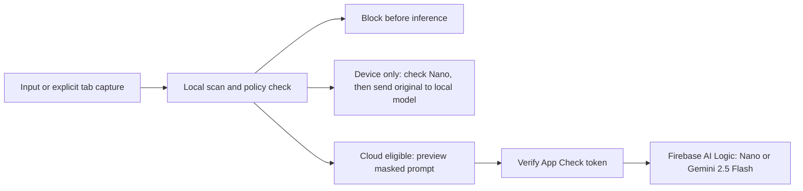

# EdgeGuard Hybrid Studio

A support ticket can contain a billing issue, a phone number and a pasted credential in the same paragraph. EdgeGuard scans the text in your browser and previews the exact prompt eligible for cloud inference. The Web app and Chrome side panel share the same privacy controls.

**#BuildHybridAI 2026 · Best Web/Chrome App** · [Devpost project story](DEVPOST_SUBMISSION.md) · [Demo recording plan](DEMO_SCRIPT_2M30S.md)

## Try the sandbox

From the directory containing `package.json`, use Node.js 24.12.0 or later and npm.

```sh
npm ci
npm run dev
```

Open the URL printed by Vite. **Sandbox Simulation** starts with a synthetic **Customer ticket** and the **Triage** task. Once the app has loaded, simulation works offline. It generates deterministic responses locally without a Firebase project, network inference or a Nano download.

| Try this in one session | What to look for |
| --- | --- |
| Leave **Strict privacy** and **Simulate Nano ready** on. Click **Run simulation**. | The credential makes this ticket high risk. The route reads `ONLY_ON_DEVICE`, the cloud preview is empty and the response badge reads **Simulated · On device**. |
| Turn off **Simulate Nano ready**. Open **Compare**, then run again. | `PREFER_ON_DEVICE` permits fallback. The cloud payload masks the email, phone, IP address and credential. The response badge reads **Simulated · In cloud**. |
| Turn on **Offline routing** and run once more. | With neither route available, the request is **Blocked**. **Export telemetry JSON** records all three outcomes under the sandbox runtime. |

## How a live request works



- **Scan.** The scanner recognizes common email, phone, IPv4, ID and credential formats and checks card candidates with Luhn. Names, addresses and unfamiliar formats can pass through. Read the full **Cloud payload** before sending a document. [Scanner](src/core/piiGuard.ts)
- **Route.** Offline, cloud disabled, or cloud unconfigured means local only if Nano is ready, otherwise block. The same rule applies when the scanner finds identifiers and cloud redaction is off. Under strict privacy, high-risk input stays local when Nano is ready. With cloud and redaction enabled, an unavailable Nano permits masked fallback. Otherwise triage, summary and extraction prefer Nano, and deep synthesis prefers cloud. [Router](src/core/hybridRouter.ts)
- **Dispatch.** The adapter uses `GoogleAIBackend` and `InferenceMode.ONLY_ON_DEVICE`, `InferenceMode.PREFER_ON_DEVICE` or `InferenceMode.PREFER_IN_CLOUD`. Both preferred modes pass the same inspected prompt to the SDK whichever backend it selects. The configured cloud model is `gemini-2.5-flash`. Local-only dispatch checks the modern Chrome `LanguageModel` API again and stops before calling the model if only legacy `ai.languageModel` is available. [Firebase adapter](src/core/firebaseAiAdapter.ts)
- **Review.** If a readiness check makes a new or changed cloud payload eligible, the UI shows it and asks for confirmation. The response view can restore echoed email, phone and IP placeholders locally. Credential, payment card and national ID placeholders stay masked. The session JSON records counts, outcomes and timing, omits prompt and response text, and separates live and simulated runs. [Workspace](src/App.tsx) · [Telemetry schema](src/core/telemetry.ts)

## Enable live inference

1. For **live cloud**, register your own Firebase Web app, enable Firebase AI Logic with the Gemini Developer API backend and register the app for App Check with a score-based reCAPTCHA Enterprise site key. Configure the serving domain and enable App Check enforcement for AI Logic in the Firebase console. [Firebase AI Logic setup](https://firebase.google.com/docs/ai-logic/get-started) · [Web App Check setup](https://firebase.google.com/docs/app-check/web/recaptcha-enterprise-provider)
2. Copy `.env.example` to `.env.local`. Set `VITE_FIREBASE_API_KEY`, `VITE_FIREBASE_PROJECT_ID`, `VITE_FIREBASE_APP_ID` and `VITE_RECAPTCHA_ENTERPRISE_SITE_KEY`. Supply `VITE_FIREBASE_AUTH_DOMAIN` if applicable. Restart Vite or rebuild. Configured builds embed the Web configuration and public site key.
3. Select **Live Firebase AI Logic**. A cloud-eligible run obtains an App Check token before model dispatch. The bootstrap uses `ReCaptchaEnterpriseProvider`. On a supported Chrome installation, the local-only route can run without cloud configuration. If the model is downloadable, click **Prepare Gemini Nano** while online and wait for **Nano ready**. [App Check bootstrap](src/core/appCheckBootstrap.ts) · [Chrome Prompt API](https://developer.chrome.com/docs/ai/prompt-api)
4. For a test project, keep the Web config and site key in place. Enter a registered App Check debug token in **Developer settings**. Applying it stores it in tab session storage and reloads the workspace. In the Vite dev server you can instead set `VITE_FIREBASE_APPCHECK_DEBUG_TOKEN=true`, attempt a cloud-eligible run, register the SDK-generated token in the test project's console and retry. Production builds exclude that environment variable. [Firebase debug provider](https://firebase.google.com/docs/app-check/web/debug-provider)

## Build and check both packages

```sh
npx tsc --noEmit
npm run build
npx vitest run --maxWorkers=2
node --check dist-extension/background.js
```

The verified baseline passed type checking, both Vite builds, the worker syntax check and **109 tests in 7 files**. The tests use SDK mocks for live-path checks. The pinned versions are Firebase 13.4.0, React 19.2.9, Vite 8.3.8 and Vitest 4.1.12. [Package manifest](package.json) · [Tests](tests)

- **Web.** Serve `dist/` as a static site or use `npm run preview` to inspect the build locally.
- **Chrome.** In Chrome 116 or later, open `chrome://extensions`, enable **Developer mode**, choose **Load unpacked** and select `dist-extension/`. Click the EdgeGuard toolbar action on a regular page, select text, then click **Capture tab text**. With no selection and the main page focused, capture uses its visible body text. An unreadable focused frame produces an error. At the 16,000-character limit the worker rolls back incomplete numeric groups, including card, phone and SSN groups continued across lines. [Manifest](extension/manifest.json) · [Capture worker](extension/background.js)
- **Side-panel cloud setup.** Manifest V3 restricts remote scripts. For live cloud in the extension, use a test-project build with its Web configuration, Enterprise site key and a registered debug token entered in the panel. Use the hosted Web app for production reCAPTCHA Enterprise attestation. [Chrome extension policy](https://developer.chrome.com/docs/extensions/reference/manifest/content-security-policy)

## Project links

Planned public repository · <https://github.com/dustinliang666-blip/edgeguard-hybrid-studio>

Hosted demo · **[URL pending deployment]**

Demo video · **[URL pending upload]**

License · [MIT](LICENSE)
